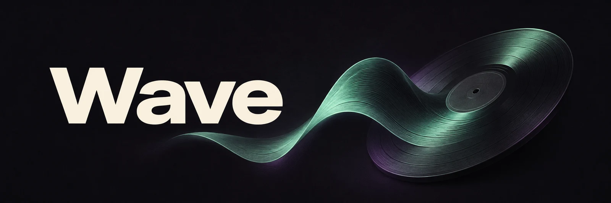
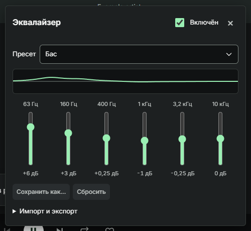

<h1 align="center">Музыка из VK в отдельном плеере</h1>

Начните с любимой песни, включите Микс или возьмите плейлист с собой без интернета.

  <a href="https://github.com/arthurhoodwin/wave/releases/latest"><strong>↓ Скачать Wave для Windows</strong></a>
  &nbsp;·&nbsp; <a href="releases/LATEST.md">Что нового</a>

Windows x64 · Для входа нужен аккаунт VK

## Сторона А · Найти что послушать

Откройте «Мне нравится» и свои плейлисты или найдите песню по названию. Если кто-то прислал ссылку VK на трек, альбом или плейлист, вставьте её прямо в поиск Wave.

Когда хочется чего-то нового, **включите VK Микс** на главной. Можно начать с конкретной песни или исполнителя, выбрать настроение и нажать «Не рекомендовать», если трек не подошёл.

## Сторона Б · Слушать по-своему

**В дорогу.** Скачайте песни заранее и слушайте их без сети. Если открыть текст скачанной песни онлайн один раз, Wave сохранит его вместе с доступными временными метками. Скачивание новых лайков можно включить в настройках.

**Подпевать.** Нажмите на обложку текущей песни, чтобы открыть развёрнутый плеер. Если у текста есть временные метки, Wave подсветит текущую строку. Нажмите на другую строку, чтобы перейти к этому моменту.

**Оставить музыку на фоне.** Управляйте ей через мини-плеер, значок в трее или мультимедийные клавиши. Таймер сна остановит музыку через выбранное время или в конце песни.

<strong>Посмотреть эквалайзер</strong>

 
Эквалайзер раскрывается над панелью воспроизведения. Настройте шесть полос и сохраните свой пресет под именем, чтобы вернуться к нему позже.

## Как начать

1. На [странице последнего выпуска](https://github.com/arthurhoodwin/wave/releases/latest) скачайте файл **Wave-Setup-…exe**.
2. Установите Wave и войдите через окно VK.
3. Откройте «Мне нравится» или включите Микс. Следующее обновление можно получить в настройках Wave.

[Руководство пользователя](docs/USER-GUIDE.md) · [Планы развития](docs/ROADMAP.md) · [Сообщить о проблеме](https://github.com/arthurhoodwin/wave/issues/new/choose)

Wave — независимый плеер для VK. Доступность музыки, текстов и Микса зависит от VK и аккаунта. На скриншотах показан демонстрационный аккаунт.

Исходники и участие в проекте

Wave распространяется по лицензии [GPL-3.0-only](LICENSE). Здесь же лежат [инструкция по сборке и форкам](DEVELOPMENT.md), [руководство для участников](CONTRIBUTING.md), [архитектура](docs/TECHNICAL.md) и [правила сообщения об уязвимостях](SECURITY.md).

