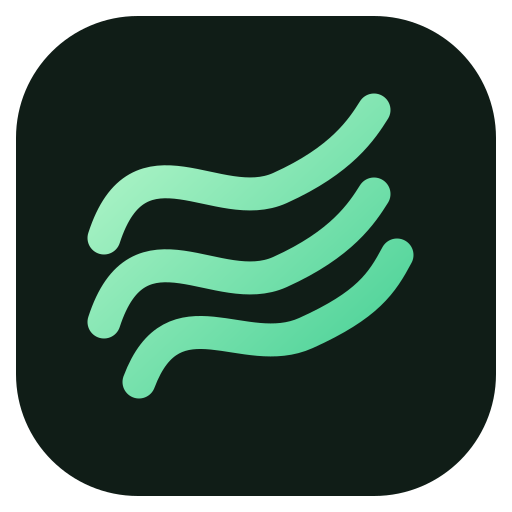
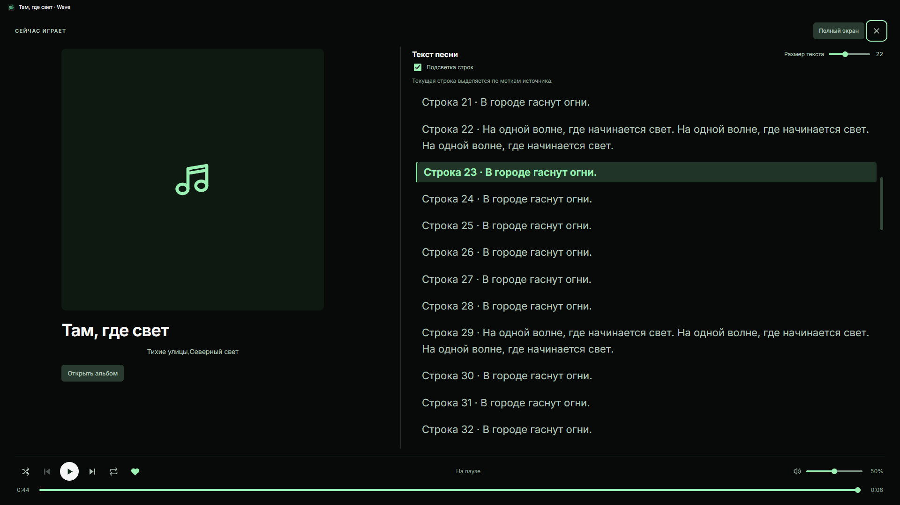
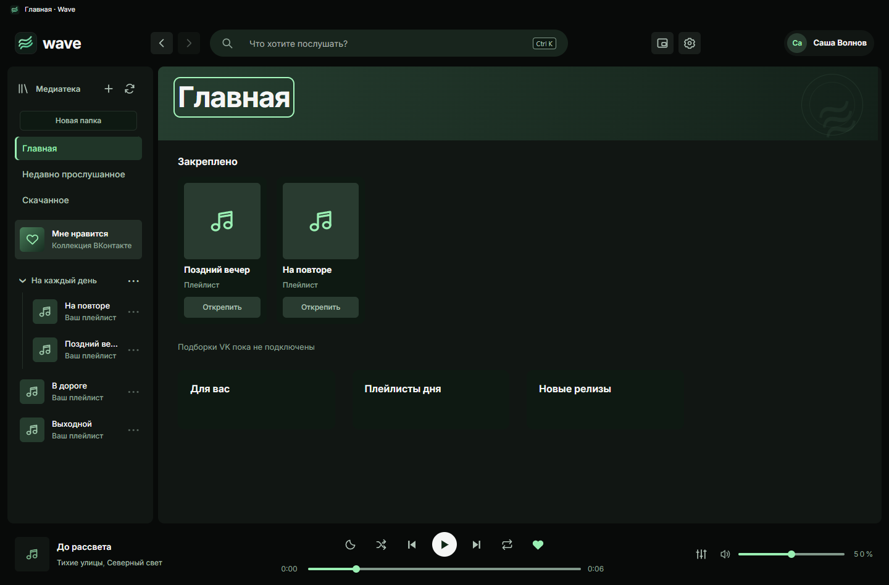

<h1 align="center">Wave</h1>

Клиент VK Музыки для Windows.

<a href="https://github.com/arthurhoodwin/wave/releases/latest"><strong>Скачать для Windows</strong></a> · <a href="https://github.com/arthurhoodwin/wave/releases/tag/v1.1.0-beta.1">Попробовать 1.1 Beta</a> · <a href="https://github.com/arthurhoodwin/wave/issues/new/choose">Сообщить об ошибке</a>

*На скриншотах — интерфейс Wave с вымышленными песнями и демо-аккаунтом.*

## Что умеет Wave

- Воспроизводить музыку из VK, искать песни, альбомы и исполнителей.
- Работать с «Мне нравится» и плейлистами: добавлять песни, удалять их и менять порядок.
- Показывать текст песни и подсвечивать строки, если для записи есть временные метки.
- Управлять музыкой из мини-плеера, трея и мультимедийными клавишами.
- Запоминать выбранную песню и позицию, настраивать звук эквалайзером и останавливать музыку по таймеру сна.

В **1.1 Beta** также доступны недавно прослушанные песни, закрепления и скачивание поддерживаемых записей для прослушивания без сети. В строке песни сердце показывает лайк, а галочка скачивания — готовую локальную копию.

## Как установить

1. Откройте [последний обычный выпуск](https://github.com/arthurhoodwin/wave/releases/latest).
2. Скачайте файл **Wave-Setup-…exe** и запустите его. Исходники и файлы `.waveupdate` для первой установки не нужны.
3. Откройте Wave, нажмите **«Войти через VK»** и войдите в своём аккаунте в открывшемся окне VK.
4. Выберите песню из медиатеки или найдите её через поиск.

Нужны **Windows x64**, подключение к интернету и аккаунт VK. Установщик пока без цифровой подписи Windows.

## Обычный выпуск или Beta?

| Выпуск | Что выбрать |
|---|---|
| [1.0.9.9.1 — обычный](https://github.com/arthurhoodwin/wave/releases/latest) | Если хотите пользоваться выпущенной версией. |
| [1.1.0-beta.1 — предварительный](https://github.com/arthurhoodwin/wave/releases/tag/v1.1.0-beta.1) | Если хотите попробовать новые функции 1.1 и помочь найти ошибки. |

Beta устанавливается вручную и использует тот же профиль. Вход и коллекция сохраняются. В настройках можно откатиться, если предыдущий установщик сохранён.

**Ограничения Beta:** скачивание поддерживает прямые файлы и совместимые завершённые HLS-записи. HLS после паузы собирается заново; прямой файл продолжается, если сервер подтверждает его неизменность. После перезапуска очередь восстанавливается на паузе. Подборки VK зависят от доступности источника для вашего аккаунта. Метаданные сохраняются рядом с аудио в JSON; встроенные теги пока не записываются. [Что изменилось в текущем выпуске](releases/LATEST.md).

## Несколько полезных действий

- Нажмите песню — она начнёт играть. Следующие песни берутся из открытого списка.
- Нажмите название или обложку в нижней панели — откроется плеер с текстом.
- В Beta сердечко в строке меняет «Мне нравится», а кнопка скачивания сохраняет локальную копию. Удаление этой копии не удаляет песню из VK.
- Кнопка с луной открывает таймер сна. В Beta она находится в плеере и доступна также в мини-плеере.
- **Ctrl+K** переводит в поиск, **F1** открывает справку по клавишам. Нижняя боковая кнопка мыши — назад, верхняя — вперёд.

## Если что-то не работает

Укажите версию Wave из конца настроек, что вы нажали и что произошло. Скриншот тоже поможет. [Создать обращение](https://github.com/arthurhoodwin/wave/issues/new/choose).

Не прикладывайте пароль, коды входа, cookies или папку профиля. Для диагностики в настройках есть отдельная кнопка экспорта.

Wave — независимый проект, не официальное приложение VK. Доступность песен и функций зависит от VK и вашего аккаунта.

## Для разработчиков

Сборка, устройство приложения и подготовка собственного форка — в **[DEVELOPMENT.md](DEVELOPMENT.md)**. Планы развития — в [роадмапе](docs/ROADMAP.md).

Лицензия исходников: [GPL-3.0-only](LICENSE). [Сторонние компоненты](docs/THIRD_PARTY_NOTICES.md) · [Правила участия](CONTRIBUTING.md) · [Безопасность](SECURITY.md).
