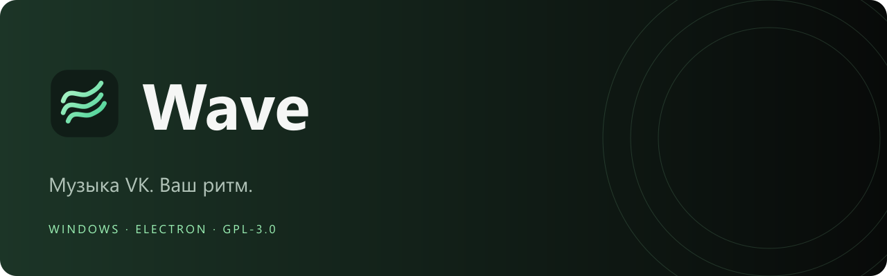
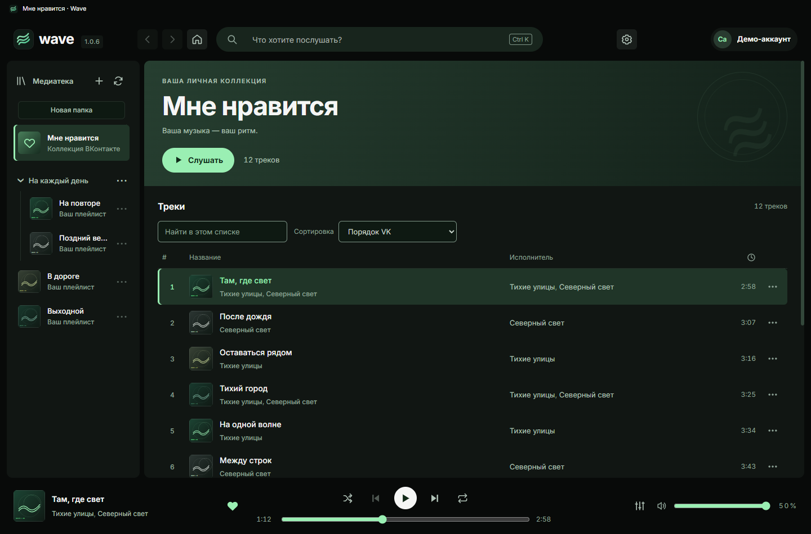
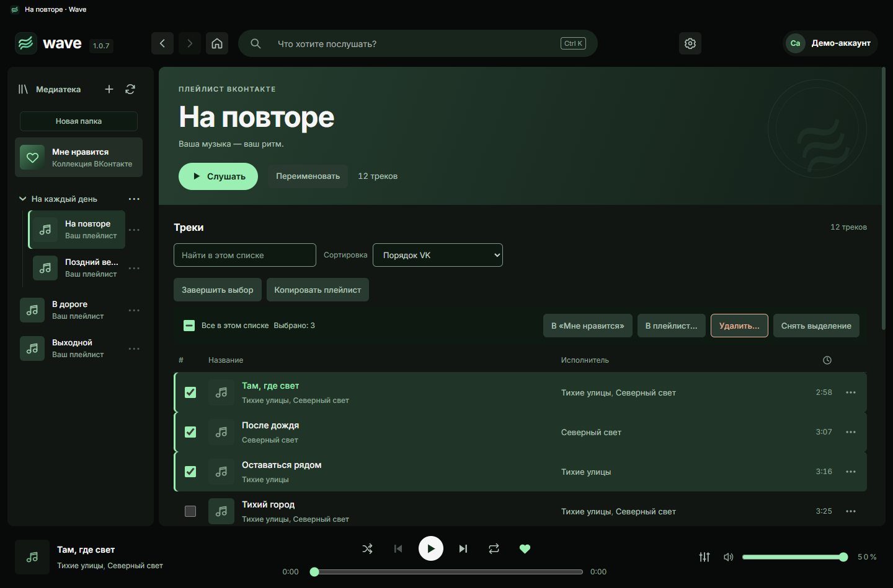
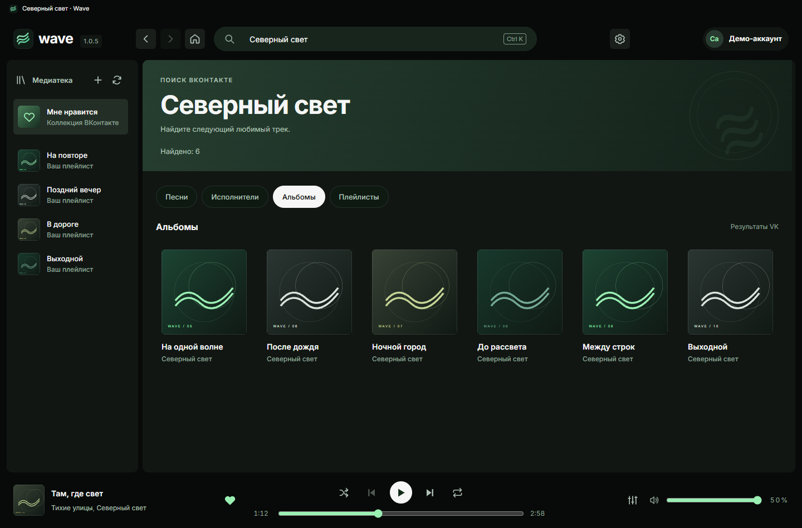
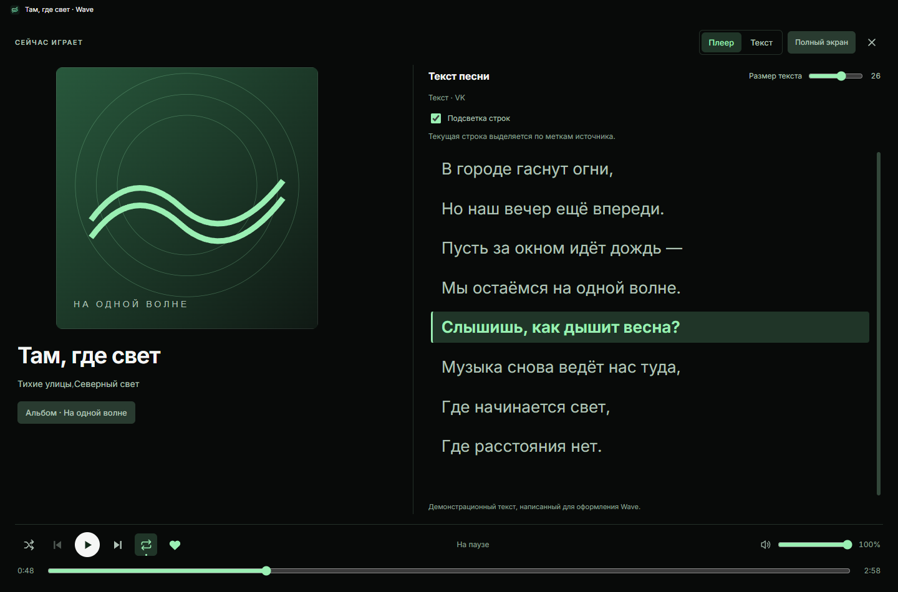
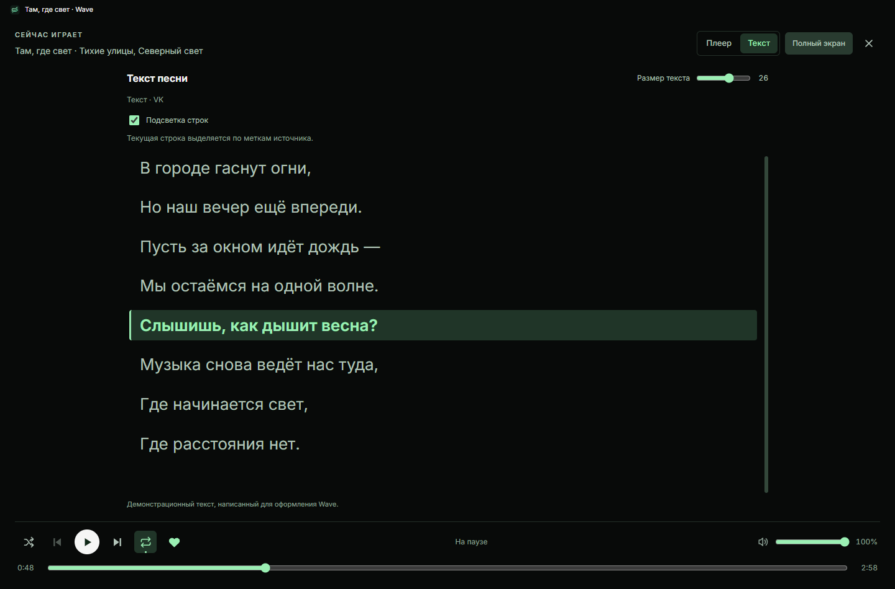
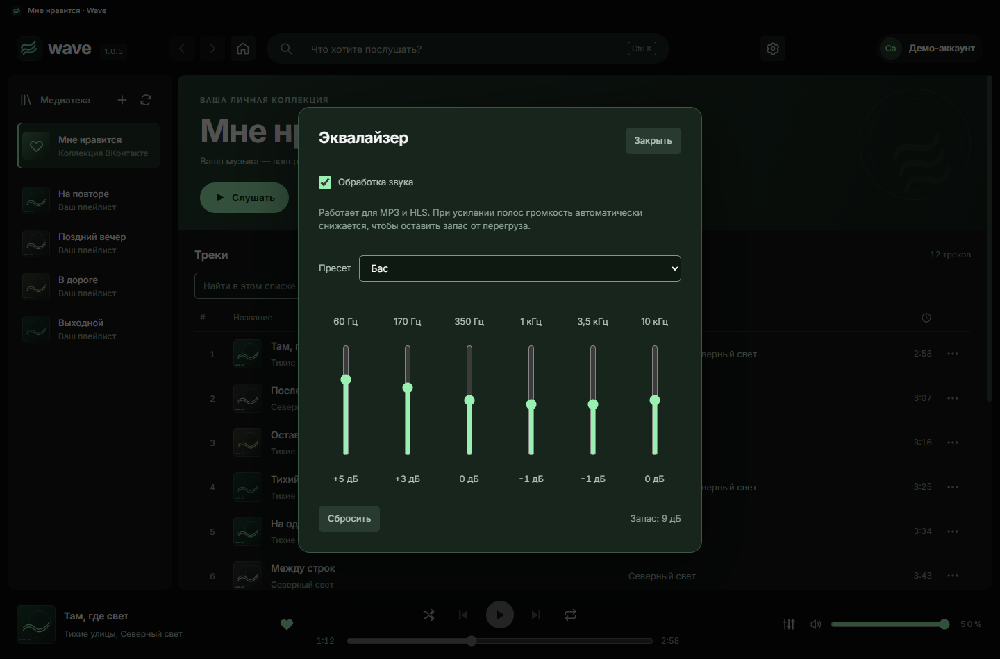
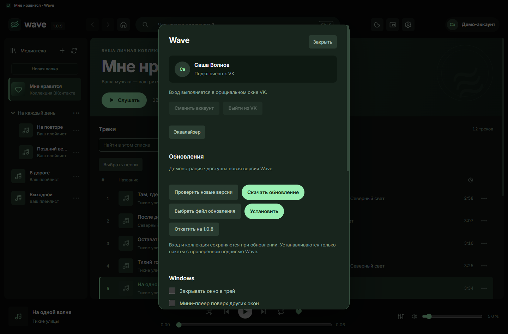

<p align="center">
  
</p>

<p align="center">
  <a href="https://github.com/arthurhoodwin/wave/releases/latest"></a>
  <a href="https://github.com/arthurhoodwin/wave/actions/workflows/ci.yml"></a>
  <a href="LICENSE"></a>
  
</p>

<p align="center">Настольный клиент VK Музыки с собственной оболочкой,<br>прямым запуском песен и спокойным тёмным интерфейсом.</p>

<p align="center">
  <a href="https://github.com/arthurhoodwin/wave/releases/latest"><strong>Скачать для Windows</strong></a> ·
  <a href="docs/ROADMAP.md">Роадмап</a> ·
  <a href="https://github.com/arthurhoodwin/wave/issues/new/choose">Сообщить об ошибке</a>
</p>

---

## Ваша коллекция — в одном окне



*На скриншотах настоящий интерфейс Wave с вымышленными песнями, обложками и демо-аккаунтом. Личные данные пользователей не используются.*

| Слушайте | Находите | Собирайте |
|---|---|---|
| Нажмите песню — она играет. Следующие берутся из текущего плейлиста или поиска. | Поиск VK, страницы альбомов и исполнителей, локальный фильтр и сортировка. | «Мне нравится», свои плейлисты, добавление и удаление песен, изменение порядка. |
| Пауза, перемотка, перемешивание, повтор песни или списка. | Назад/вперёд с сохранением позиции открытого списка. | Результат изменений проверяется повторным чтением VK. |

### Папки и большие коллекции

Создавайте локальные папки, переименовывайте и сворачивайте их. Перемещайте плейлисты перетаскиванием или через «⋯». Структура сохраняется в Wave; плейлисты VK не меняются. Списки виртуализированы, а повторный переход не пересылает неизменные данные целиком.

### Коллекция без лишних действий



Выбирайте несколько песен, добавляйте и удаляйте их с подтверждением результата VK. Копируйте плейлист в свою коллекцию, меняйте порядок перетаскиванием или через меню песни. Нижняя боковая кнопка мыши возвращает назад, верхняя ведёт вперёд; колёсико не переназначено.

### Поиск по типам



Четыре раздела каталога VK, постепенное раскрытие результатов и возврат к загруженным страницам. Недавние запросы доступны в поисковой строке и хранятся локально в зашифрованном виде. Ошибка поиска имеет отдельную повторную попытку. Числовых счётчиков результатов нет; точное количество песен в коллекциях сохранено.

### Откройте песню целиком



Нажмите название или обложку в нижнем плеере. Здесь доступны все исполнители, переход к альбому, транспорт, громкость и сердечко. Кнопка «Полный экран» разворачивает окно; Escape возвращает обратно.



Режим «Текст», размер 16–32 пикселя и подсветка по настоящим меткам VK/LRCLIB. Ручная прокрутка приостанавливает слежение; «К текущей строке» возвращает его. Без меток доступен обычный текст. Уже полученный текст открывается без сети из ограниченного кэша, который очищается при выходе. Это не офлайн-хранение аудио.

После VK запасными источниками остаются Genius, LRCLIB и lyrics.ovh. Доступность зависит от сервиса; на проверенной сети Genius возвращал 403.

### Windows, как вы привыкли

- Мультимедийные клавиши и системное управление воспроизведением.
- Мини-плеер, трей и таймер сна.
- Восстановление выбранной песни и позиции без автоматического запуска звука.
- Локальный Inter Variable, мятный акцент, поддержка уменьшенного движения.
- Постепенное раскрытие песен при прокрутке. Без кнопки «Загрузить ещё».

### Эквалайзер



Шесть полос ±12 дБ, четыре пресета, сброс и обход обработки. Работает для MP3/HLS; применяется сразу и сохраняется между запусками. Открывается возле громкости или в настройках. При усилении полос автоматически оставляется запас громкости.

### Обновления и переходы



Проверка новых выпусков GitHub, загрузка с прогрессом и отменой, Ed25519-подпись и откат на сохранённый установщик. После некорректного завершения можно открыть восстановление.

Crossfade 0–12 секунд и отдельная предзагрузка следующей песни доступны в настройках. Перекрытие по умолчанию выключено, действует на автоматический переход; ручной выбор и перемотка его отменяют. Gapless для всех форматов не заявлен.

## Установка

1. Скачайте **Wave-Setup-1.0.9.5.exe** в [Releases](https://github.com/arthurhoodwin/wave/releases/latest).
2. Установите и откройте Wave.
3. Выберите **«Войти через VK»** и завершите вход в официальном окне VK. Пароль и коды в issues или чат отправлять не нужно.

**С версий до 1.0.9 включительно переходите через установщик 1.0.9.5:** прежний загрузчик не распознаёт четырёхчастный номер.

Нужны Windows x64, интернет и аккаунт VK. Установщик пока **без Authenticode-подписи**. Пакеты `.waveupdate` имеют отдельную подпись Wave Ed25519; это другой механизм, он не заменяет подпись Windows.

Обновление из файла: **Настройки → Выбрать файл обновления**. Wave проверяет подпись пакета, поддерживает откат к сохранённому установщику. Проверка GitHub доступна в настройках: «Проверить новые версии» → «Скачать обновление» → «Установить». Проверка запускается пользователем; фоновой установки нет.

## Что важно знать

Wave — независимый проект, не официальный клиент VK и не продукт Spotify. Код и ресурсы Spotify не используются.

- Адаптер использует внутренний веб-протокол VK. Изменения сервиса могут временно нарушать отдельные функции.
- Доступность записей зависит от VK, аккаунта и прав на конкретную песню. Ограничения сервиса сохраняются.
- Офлайн-прослушивания нет. Кэш хранит метаданные и позволяет просматривать ранее загруженные списки.
- Вход через браузер по умолчанию пока не реализован: используется отдельное официальное окно VK.
- В 1.0.5 основная выдача использует каталог поиска VK с отдельными разделами. Результаты и их релевантность зависят от сервиса.

## Дальше — 1.1

| Версия | Основной фокус |
|---|---|
| **1.0.4** | Надёжность воспроизведения + эквалайзер |
| **1.0.5** | Исправление поиска + разделы песен, альбомов, исполнителей и плейлистов |
| **1.0.6** | Виртуализация и планировщик + папки плейлистов |
| **1.0.7** | Массовые действия, копирование плейлистов, боковые кнопки мыши + запасные источники текста песни |
| **1.0.8** | Полноэкранный плеер и режим текста |
| **1.0.9** | Обновления внутри Wave + crossfade и проверка gapless |
| **1.0.9.5** | Шлифовка настроек и перемотка в незагруженное аудио |
| **1.1** | Домашняя, история, медиатека, следующие песни, скачивание и офлайн-библиотека |

План и критерии готовности — в [ROADMAP.md](docs/ROADMAP.md). Это направление развития, а не обещание сроков.

## Разработка

Node.js **24 LTS**, npm, Windows x64. Версии Electron и зависимостей закреплены в lock-файле.

```powershell
git clone https://github.com/arthurhoodwin/wave.git
cd wave
npm ci
npm test
npm start
```

Если Electron не скачался при установке зависимостей: `node node_modules/electron/install.js`.

Сборка установщика: `npm run dist`. Результат — в соседнем каталоге `dist/`. Подпись `.waveupdate` требует отдельного закрытого ключа, которого в репозитории нет. Сторонняя сборка с другим ключом не принимается как официальное обновление существующей Wave.

### Как всё устроено

```text
Интерфейс HTML / CSS / JS
          │ ограниченный IPC
          ▼
Electron main ─── VK-адаптер ─── VK
          │
          ├── защищённый кэш метаданных
          └── локальный аудиопрокси ─── HTMLAudio / Hls.js
```

Токены остаются в основном процессе. Плеер получает временный непрозрачный адрес localhost, а не исходную подписанную ссылку CDN. Сеанс VK хранится в отдельном профиле Electron. Файлы профиля не входят в репозиторий.

В 1.0.9.5 — **184 успешных автоматических проверок** на машине разработки. Текущий результат CI виден в значке выше. Это не заменяет проверку на разных компьютерах.

## Участие

Нашли ошибку? [Создайте issue](https://github.com/arthurhoodwin/wave/issues/new/choose) с версией, шагами и ожидаемым результатом. Не прикладывайте cookies, токены, профиль Electron или полные потоковые ссылки.

Перед PR прочитайте [CONTRIBUTING.md](CONTRIBUTING.md). Сообщения о приватных данных и уязвимостях — по [SECURITY.md](SECURITY.md).

## Лицензия и благодарности

Исходники Wave опубликованы под **[GNU GPL v3.0 only](LICENSE)**. Лицензии сторонних компонентов сохраняются отдельно: [THIRD_PARTY_NOTICES.md](docs/THIRD_PARTY_NOTICES.md).

Electron · Hls.js · Inter Variable · electron-builder. Музыка и данные VK не становятся частью лицензии Wave.

Структура каталогов и порядок релиза: [docs/STRUCTURE.md](docs/STRUCTURE.md). Актуальные заметки: [releases/LATEST.md](releases/LATEST.md).

[Состояние реализации роадмапа](docs/ROADMAP-AUDIT.md): готовые функции, частичная реализация и оставшиеся задачи.
