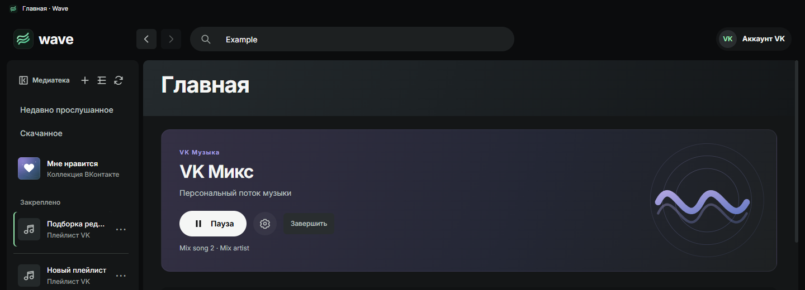
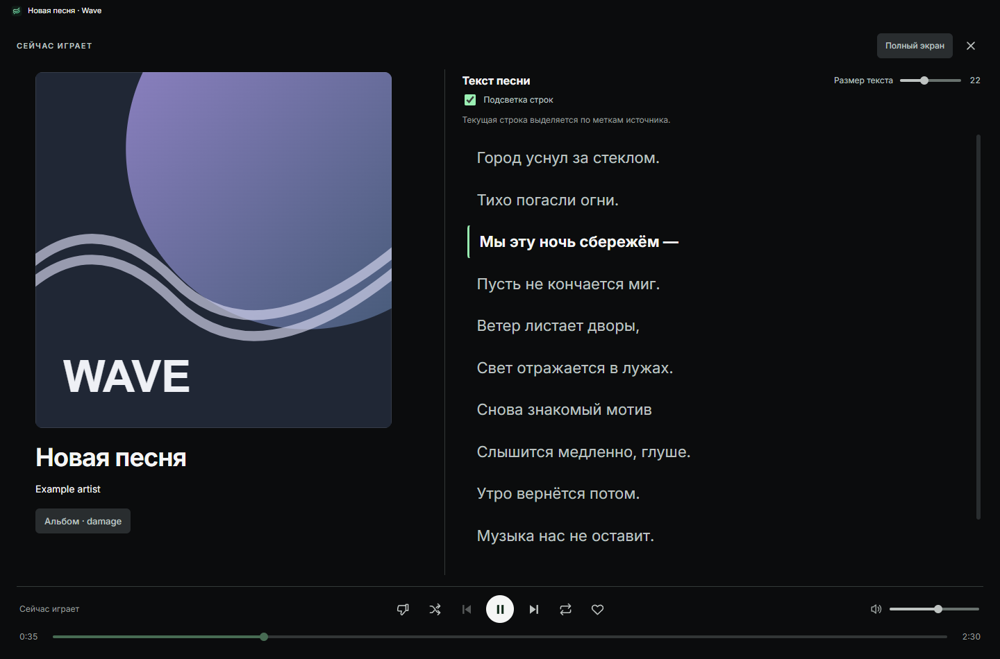

<h1 align="center">Wave — настольный плеер для музыки VK</h1>

Ваша медиатека, плейлисты и VK Микс в одном приложении для Windows.

  <a href="https://github.com/arthurhoodwin/wave/releases/latest"><strong>↓ Скачать Wave для Windows</strong></a>
  &nbsp;·&nbsp; <a href="releases/LATEST.md">Что нового</a>

Windows x64 · Для входа нужен аккаунт VK

## О проекте

Wave — независимый проект для тех, кто хранит музыку во ВКонтакте и хочет слушать её в отдельном окне. Вход через VK открывает знакомую коллекцию: «Мне нравится», сохранённые альбомы и плейлисты. В Wave их можно разложить по папкам, закрепить в медиатеке и дополнить скачанными копиями для прослушивания без сети.

Главная посвящена поиску новой музыки. Здесь есть подборки и персональный VK Микс, который можно запустить по песне или исполнителю. Музыка продолжает играть, пока вы переходите между страницами и открываете другие плейлисты.

## Что уже есть в Wave

- **Медиатека VK.** Поиск песен, артистов, альбомов и плейлистов, открытие ссылок VK и редактирование своих подборок.
- **Скачанная музыка.** Локальные копии, автоматическое скачивание новых лайков по желанию и управление местом на диске.
- **Развёрнутый плеер.** Обложка и текст рядом. Когда у текста есть временные метки, текущая строка подсвечивается, а нажатие на строку перематывает песню. Открытые тексты скачанных песен доступны без сети.
- **Итоги месяца.** Локальный архив с временем прослушивания и любимыми песнями и исполнителями.
- **Управление на рабочем столе.** Мини-плеер, мультимедийные клавиши, таймер сна и плавные переходы между песнями.

## Куда развивается Wave

В плане мини-плеер с горячей клавишей и свободным размещением на мониторе, а также вкладка «Друзья» при подтверждении доступа к их музыке через VK. В **1.3.0** планируются медиатека из собственных папок и экспериментальный режим караоке. [Роадмап по версиям](docs/ROADMAP.md)

## Установка

Скачайте **Wave-Setup-…exe** со [страницы последнего выпуска](https://github.com/arthurhoodwin/wave/releases/latest), запустите установщик и войдите через окно VK. Обновления доступны в настройках Wave. [Руководство пользователя](docs/USER-GUIDE.md) · [Сообщить о проблеме](https://github.com/arthurhoodwin/wave/issues/new/choose)

Wave не связан с VK. Доступность музыки, текстов и Микса зависит от VK и аккаунта. На скриншотах показаны демонстрационные данные.

Исходники и участие в проекте

Wave распространяется по лицензии [GPL-3.0-only](LICENSE). [Сборка и форки](DEVELOPMENT.md) · [Участие в проекте](CONTRIBUTING.md) · [Архитектура](docs/TECHNICAL.md) · [Сообщения об уязвимостях](SECURITY.md)

