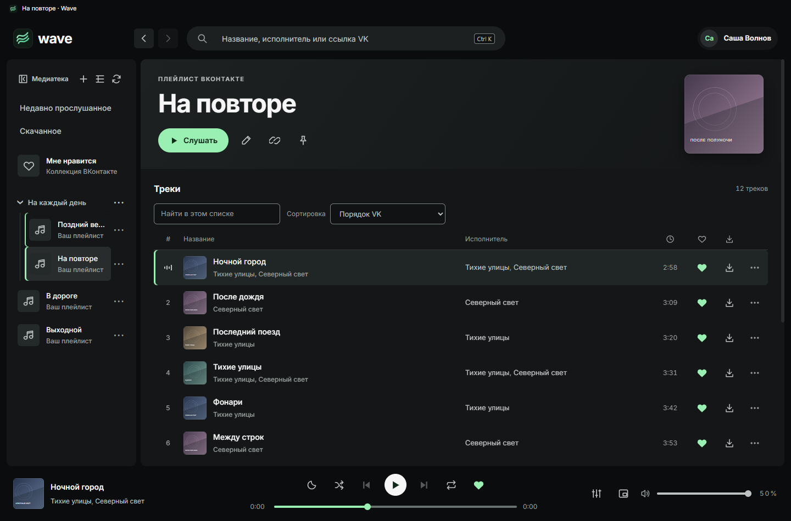
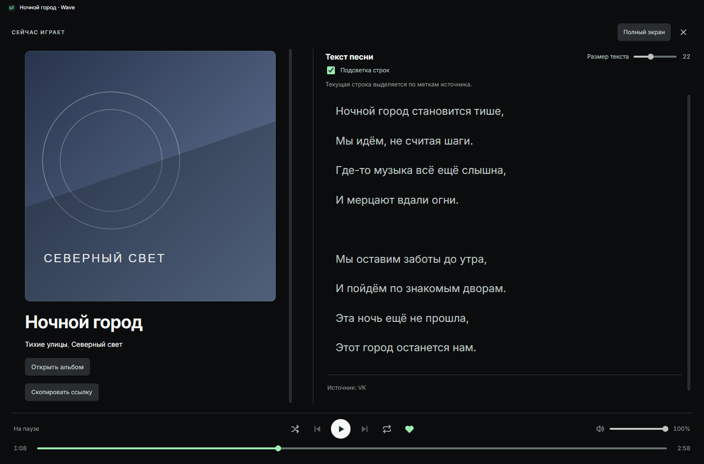

<h1 align="center">Wave</h1>

<strong>VK Музыка в отдельном приложении для Windows.</strong>

Плейлисты, любимые песни, тексты и скачанная музыка — на рабочем столе.

  <a href="https://github.com/arthurhoodwin/wave/releases/latest"><strong>Скачать для Windows</strong></a>
  &nbsp;·&nbsp; <a href="releases/LATEST.md">Что нового</a>
  &nbsp;·&nbsp; <a href="docs/ROADMAP.md">Планы развития</a>

Скриншоты актуального интерфейса с демонстрационным аккаунтом. Песни, обложки и тексты вымышлены.

## Коллекция из VK

Находите песни, исполнителей, альбомы и плейлисты. Открывайте музыку по ссылке VK, добавляйте понравившееся в «Мне нравится» и собирайте собственные плейлисты.

На главной доступны подборки VK: алгоритмические и редакционные плейлисты, новые альбомы и рекомендации треков — по данным аккаунта.

Медиатеку можно организовать по папкам, закрепить нужные списки и свернуть до узкой колонки. На страницах артистов — баннеры, треки и релизы; недавно прослушанные песни доступны в отдельном разделе.

## Плеер с текстом песни

Открывайте песню на весь экран, читайте текст рядом с обложкой и переходите к нужному моменту нажатием на строку, если у текста есть временные метки.

## Слушать без сети

Сохраняйте доступные записи в Wave и слушайте готовые локальные копии без интернета. По умолчанию скачиваются до трёх песен одновременно. Можно включить автоскачивание новых лайков и упорядочить скачанное как «Мне нравится». Новые MP3 получают теги и доступную обложку. Статус загрузки виден прямо в списке; её можно приостановить и продолжить. Удаление локальной копии не удаляет песню из VK.

## Управление на рабочем столе

- **Мини-плеер и трей** — управление музыкой, пока основное окно свёрнуто.
- **Мультимедийные клавиши и горячие сочетания** — пауза, переключение песен и быстрый поиск.
- **Эквалайзер и плавный переход между песнями** — настройки воспроизведения.
- **Таймер сна** — остановка музыки по выбранному времени.

## Начать слушать

1. [Скачайте установщик Wave](https://github.com/arthurhoodwin/wave/releases/latest) — файл **Wave-Setup-…exe** — и установите приложение.
2. Войдите в аккаунт через окно VK.
3. Откройте медиатеку или найдите первую песню.

Для работы нужны **Windows x64**, аккаунт VK и интернет. После скачивания песен их можно слушать без сети.

[Установка, управление и обновления](docs/USER-GUIDE.md) · [Сообщить об ошибке или предложить идею](https://github.com/arthurhoodwin/wave/issues/new/choose)

Wave — независимый проект, не официальное приложение VK. Доступность музыки и отдельных разделов зависит от VK и аккаунта.

---

## Разработчикам

Запуск из исходников, сборка и создание форка описаны в **[DEVELOPMENT.md](DEVELOPMENT.md)**.

[Устройство приложения](docs/TECHNICAL.md) · [Дизайн-код](docs/DESIGN-SYSTEM.md) · [Тестирование](docs/TESTING.md) · [Выпуск обновлений](docs/UPDATES.md)

[Правила участия](CONTRIBUTING.md) · [Безопасность](SECURITY.md) · [Сторонние компоненты](docs/THIRD_PARTY_NOTICES.md)

Исходники распространяются по лицензии **[GPL-3.0-only](LICENSE)**.
