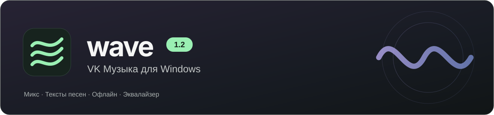
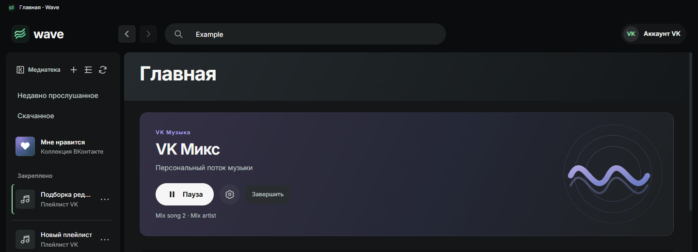
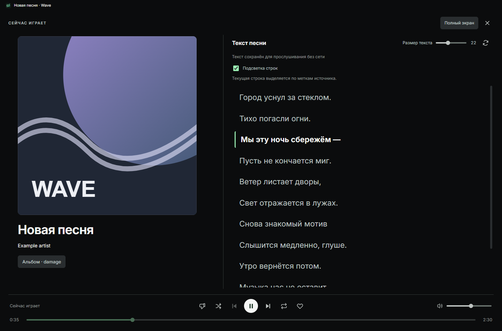
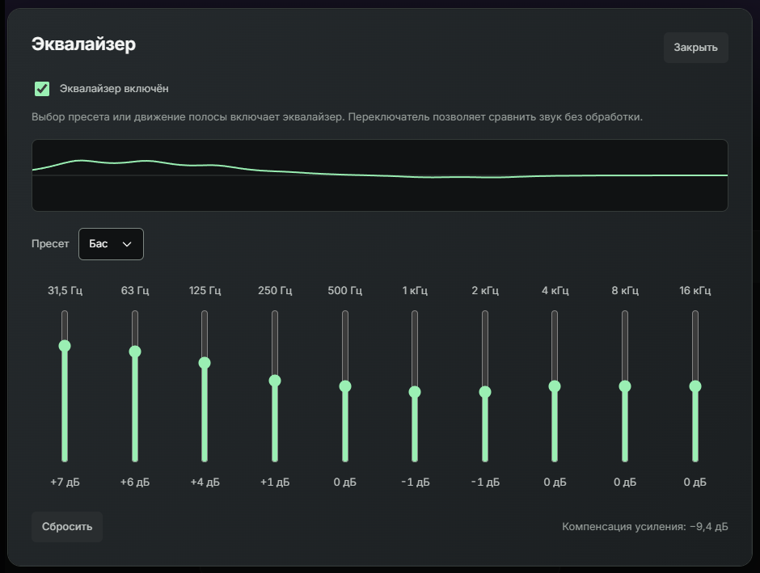

Песни из VK, персональный Микс, тексты и скачанная музыка — в отдельном приложении.

  <a href="https://github.com/arthurhoodwin/wave/releases/latest"><strong>Скачать Wave для Windows</strong></a>
  &nbsp; · &nbsp; <a href="releases/LATEST.md">Что нового в 1.2</a>
  &nbsp; · &nbsp; <a href="https://github.com/arthurhoodwin/wave/issues/new/choose">Обратная связь</a>

Windows x64 · Аккаунт VK · GPL-3.0

## VK Микс

Включайте персональный поток с главной или запускайте Микс по песне и исполнителю. Новая музыка подгружается во время прослушивания, будущая очередь остаётся скрытой.

Настраивайте настроение, узнаваемость и язык из вариантов, доступных в VK. Кнопкой «Не рекомендовать» можно исключить песню из рекомендаций и отменить действие из уведомления.

## Медиатека и офлайн

- **Поиск и ссылки VK.** Находите песни, артистов, альбомы и плейлисты; открывайте музыку по ссылке.
- **Коллекция.** Добавляйте песни в «Мне нравится», создавайте плейлисты, сохраняйте альбомы и подборки других пользователей.
- **Порядок в медиатеке.** Папки, закрепления, настройка ширины и узкая колонка с обложками.
- **Скачанное.** До трёх загрузок одновременно, пауза и продолжение, автоскачивание новых лайков по желанию. Готовые копии доступны без сети; новые MP3 получают теги и обложку.
- **История.** Недавно прослушанные песни и открытые альбомы/плейлисты собраны по категориям.

## Текст рядом с песней

В развёрнутом плеере обложка и сведения о песне находятся рядом с текстом. Если доступны временные метки, текущая строка подсвечивается, а нажатие на строку перематывает песню. Открытый текст скачанной песни сохраняется для прослушивания без сети.

<strong>Посмотреть развёрнутый плеер</strong>

 

## Звук и управление

Десятиполосный EQ с пресетами, ручной настройкой и кривой частотной характеристики. Выбор пресета сразу включает обработку; переключателем можно сравнить звук без неё.

- **Мини-плеер и трей** — управление музыкой поверх других окон или из области уведомлений.
- **Мультимедийные клавиши** — воспроизведение и переключение песен без поиска окна Wave.
- **Таймер сна** — выбранное время или конец текущей песни.
- **Плавные переходы** — настраиваемое перекрытие между песнями.
- **Обновления в приложении** — подписанные пакеты, сохранение настроек и возможность отката.

Снимки сделаны на демонстрационном стенде без личных данных. Доступность музыки, текстов и вариантов Микса зависит от VK и аккаунта.

## Начать слушать

1. [Скачайте установщик](https://github.com/arthurhoodwin/wave/releases/latest) — файл **Wave-Setup-…exe**.
2. Установите Wave и войдите через окно VK.
3. Откройте медиатеку, найдите песню или включите Микс.

[Установка, клавиши и обновления](docs/USER-GUIDE.md) · [Планы развития](docs/ROADMAP.md)

Wave — независимый проект, не официальное приложение VK. Скачанная музыка остаётся в выбранной папке; удаление локальной копии не удаляет песню из VK.

---

## Для разработчиков и авторов форков

Исходники открыты по **[GPL-3.0-only](LICENSE)**. Запуск, сборка и подготовка форка — в **[DEVELOPMENT.md](DEVELOPMENT.md)**.

[Архитектура](docs/TECHNICAL.md) · [Дизайн-код](docs/DESIGN-SYSTEM.md) · [Проверки](docs/TESTING.md) · [Выпуск обновлений](docs/UPDATES.md) · [Участие](CONTRIBUTING.md) · [Безопасность](SECURITY.md) · [Сторонние компоненты](docs/THIRD_PARTY_NOTICES.md)
