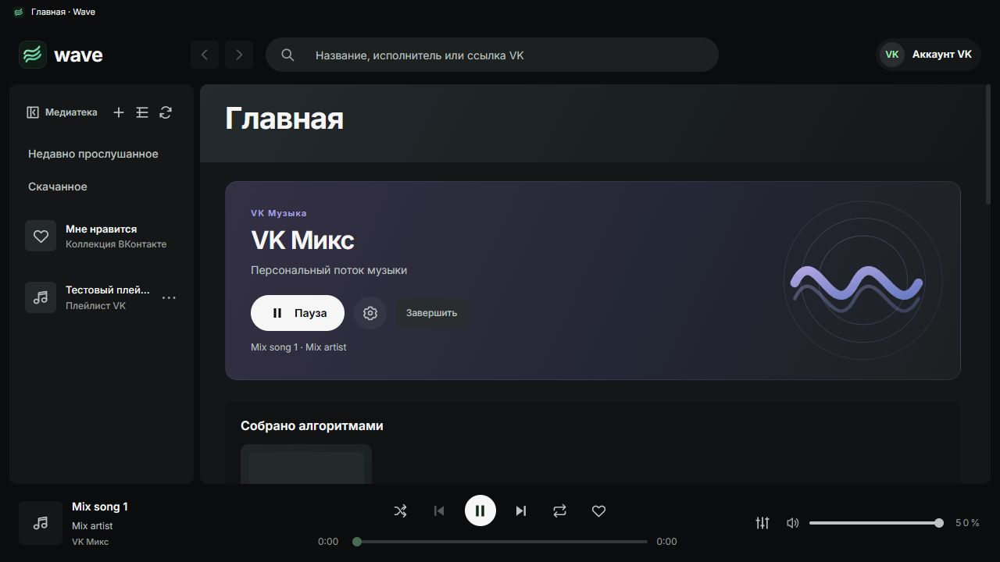

# VK Микс ·1.2.0-alpha.2

27 октября2026. Первый этап1.2: настоящий common-поток, отмена и ограниченный буфер. Это предварительный выпуск; настройки/seed/feedback не объявляются реализованными.

## Контракт и доказательства

REA заново разобрал c7995f35.54855bb3.js: parent ev_52ef73d0a01edae7b1ce91a208f9612736e18f495df29be12a84ded0f5e50380, summary ev_e6fde53ffd45318eff0ba9f016cb79e2336890d32f168cac96bcdef760653385. Статический граф частичный; исходник не исполнялся. Ручная проверка точных байтов: getStreamMixAudios byte26211 передаёт mix_id, optional entity_id/options/ref; результат — массив audio, добавляемый к списку. getStreamMixSettings byte40199; функцияC byte16929 преобразует settings.mix_categories. Типы common/my_music/track_mix/artist_mix и другие найдены в модуле30017, но этот факт сам по себе не доказывает доступность seed.

По публичному script-urls.json получен common.1151d726.js. AudioApi module518943 byte1452766: namespace audio, makeMethod(getStreamMixAudios/getStreamMixSettings). ApiNamespace module373285 строит namespace.method и передаёт параметры APIClient. Это устанавливает audio.getStreamMixAudios и audio.getStreamMixSettings; не публичный официальный API-контракт, может измениться.

Пользователь отдельно разрешил нормально закрыть Wave, прочитать конфигурацию и две порции через обычный VK-адаптер и вернуть Wave. Проверка завершена: settings присутствует; common вернул два массива по3 валидных доступных audio, между ними0 повторов. Сетевых записей/воспроизведения/изменения коллекции не выполнялось. Настройки сервера: vibes(happy,sad,active,calm,love), recognitions(known,unknown,fresh), langs(ru,international,instrumental); UI настроек пока не включён. Отчёт вне репозитория: work/probe120-read.json, публичные ресурсы work/vk120-contract. Отчёт содержит только схему, количества и публичные названия конфигурации; credentials/audioURLs/личные названия не сохранены.

## Реализация

- vk-http.cjs: только два новых read-метода в allowlist. mixAudios вызывает common сfresh:true, priority playback, AbortSignal; максимум100 audio/порция, обычные audioRow/rememberAudio. Нет execute, произвольного метода или команд учёта прослушиваний/skip.
- mix-session.cjs: один контекст на аккаунт, opaque id, совместное ожидание одной дозагрузки, немедленная отмена при stop/restart/смене аккаунта/выборе другой песни. Поздний ответ не применяется. Порции не сбрасывают content cache. До60 треков,1000 последних ключей для исключения повторов; удаление старых handles и ненужных private audio references. Три порции без новых доступных песен или пустой массив завершают продолжение. Бесконечных автоматических повторов нет.
- mix-ui.js: отдельный маршрут и компактная карточка главной. Дозагрузка при остатке одной песни, повтор при ручном запросе, статус только загрузки/ошибки, источник в now-copy. Отдельной панели очереди нет. Смена других страниц не останавливает музыку; новый выбранный трек отменяет старую дозагрузку.
- Строки используют стандартные like/download/album/lyrics. Ошибка следующей порции не вызывает pause/play текущей. Завершение Микса отменяет запрос и ставит его воспроизведение на паузу, обычные песни не меняет.

## Границы Alpha

Проверены реальное read-only получение порций и конфигурации, Node-контракты, изолированное UI-воспроизведение/дозагрузка/ошибка/остановка. Реальное многоминутное прослушивание, влияние персонализации и действия VK feedback не проверялись. Не отправляются дополнительные аналитические или обучающие события. При отсутствии сети новый поток недоступен, готовые локальные песни работают как прежде.

Настройки по конфигурации, подтверждённые seed и feedback — Beta. Непрерывное длительное прослушивание/восстановление сети/профилирование — RC. Stable1.2 не объявляется готовой этим выпуском.

## Поставка Alpha

Встроенная проверка получает только GitHub Latest Stable. Поэтому Alpha публикуется как prerelease с установщиком, подписанной дельтой от1.1.9.9 и суммами; каталог Stable и его runtime-пакеты не заменяются. Именованный файл можно выбрать вручную в настройках. Исходный packager пытался выпустить Stable-only OTA-каталог для prerelease; проверка формата отклонила его до публикации. Исправлен только внешний маршрут упаковки preview, приложение повторно не собиралось и Stable-валидатор не ослаблялся. При следующем Stable каталог должен сохранять stable-only версии/рёбра для старых клиентов; выход из Alpha обеспечивается совместимым runtime-пакетом, а не добавлением alpha-рёбер в старую схему.

## Alpha2 · скрытый поток и управление

По уточнению владельца видимый список Микса удалён. mix-ui.js больше не переходит к route mix и не пишет порции в state.allTracks. Результат open используется только для внутреннего playContext/loop; more меняет только этот буфер. Старый маршрут mix перенаправляется на главную. Карточка входит в desired узлы HomeFeed, а не вставляется отдельным sibling рядом с шапкой: место в сетке и gap24px стабильны. Место текущей песни зарезервировано, чтобы её появление не меняло прокрутку. SVG-волна статична; будущие песни не попадают в DOM.

mix-config.cjs нормализует только серверные категории/варианты; значения пользователя проверяются по ним. Параметр options соответствует найденному SDK: числовой id и массив из одного значения для каждой выбранной категории. Сброс — отсутствие options, без отдельной серверной записи. Настройки действуют в текущем запуске, их сохранение между перезапусками не обещается. Seed разрешается только из зарегистрированной песни/artist entity; renderer не передаёт произвольный native id. Источник track_mix получает owner_id_audio_id, artist_mix — идентификатор проверенного artist route.

Пользователь разрешил ещё три read-only проверки на своём сеансе, но новый процесс Electron остановился из-за sandbox/ACL/crypto среды до запросов VK. Эти проверки не пройдены. Обычный Wave возвращён через Computer Use. Подтверждение common/settings из Alpha1 сохраняется; настройки с options и seed в Alpha2 остаются экспериментальными до натурного запуска. Новых аналитических/feedback-записей нет.

Локальные Node-проверки:435 passed. Браузерный стенд на тех же renderer и fixture подтвердил запуск, применение настроек, смену песни и скрытую очередь. Gap карточки от шапки24px; scrollTop до/после запуска41/41; будущий Mix song3 отсутствует в видимом DOM. Нативные Electron-гейты этой сессии не выполнены: Windows отклоняет запуск бинарника из node_modules по ACL. Авторизация gh в командном контексте также возвращает401 после сообщения пользователя об обновлении; причина различия контекстов не установлена. До устранения этих ограничений выпуск не считать опубликованным или установленным.

Для завершения в обычном контексте владельца подготовлены work/finalize120a2.ps1 и install120a2.ps1 вне репозитория. Они не выполняются автоматически из ограниченной среды. Локальная поставка проверена по143 исходникам и77 файлам применения/отката; малый пакет296420байт.
