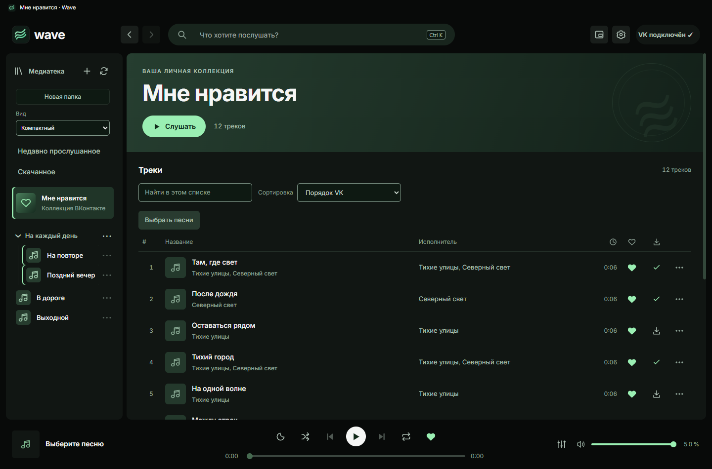
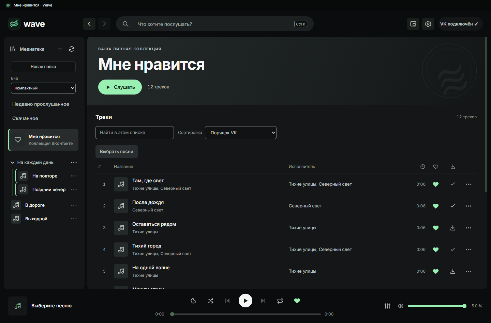
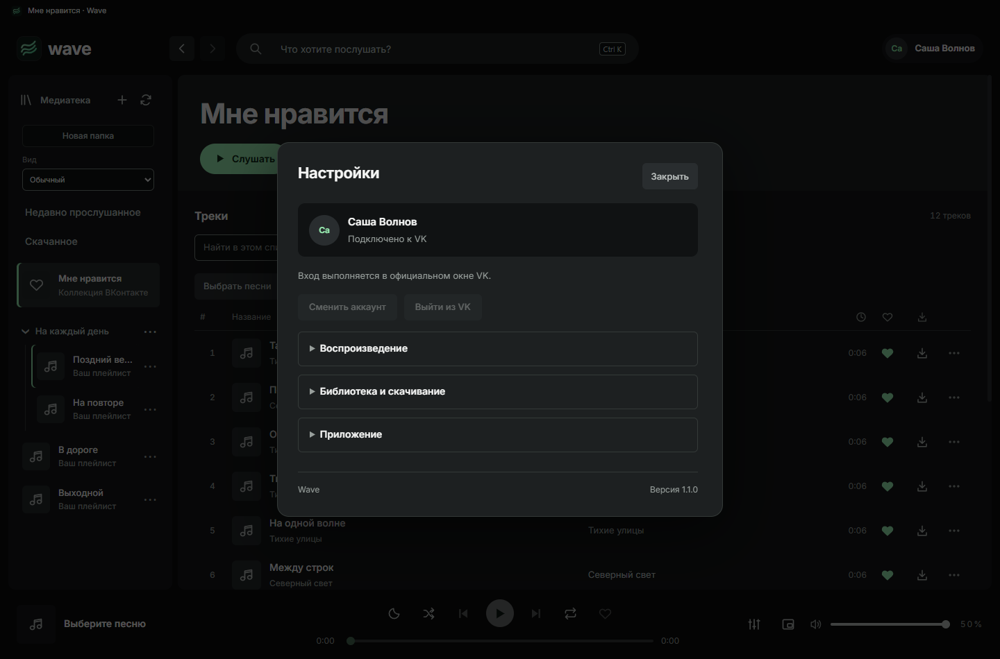

# Аудит интерфейса Wave

Дата: 24 октября 2026. Основа: код **1.1.0-beta.5**. Ниже сохранён исходный аудит **Beta 5**; реализация и повторная проверка **Beta 6** описаны в конце.

## Область и покрытие

Проверен путь «Главная → Мне нравится → развёрнутый плеер/текст → настройки», включая состояние без выбранной песни, недоступные подборки на демонстрационной Главной, узкую ширину и увеличение. Стек: Electron, обычный DOM/JavaScript, CSS-переменные и последовательные таблицы стилей. Найдены CONTRIBUTING.md, DEVELOPMENT.md, docs/DESIGN-SYSTEM.md; применимых AGENTS.md в предках checkout нет.

Применены better-interface и все шесть владельцев областей: better-accessibility, better-layout, better-writing, better-typography, better-colors, better-ui. Прочитаны относящиеся к выводам справочники contrast, color-usage, token-naming, palette-structure, spacing-and-adaptivity, motion-and-zoom, wrapping-and-punctuation, surfaces, icons и patterns.

Прежнее требование сохранить палитру зафиксировано в DESIGN-SYSTEM.md. Текущий запрос владельца разрешает пересмотреть распределение зелёного и нейтральные поверхности. Мятный фирменный акцент сохраняется; новая палитра ниже — предложение, не нормативный результат измерения вкуса.

| Область | Что проверено | Результат |
| --- | --- | --- |
| Accessibility | Axe на Главной, коллекции, настройках, плеере; 320 px, 200%; видимый фокус кнопки через Tab; computed opacity меню | Один HIGH: контраст троеточия плейлиста. Полный обход клавиатурой и скринридер не проверены |
| Layout | Снимки экранов 1440×950; коллекция/плеер при 320 px и 200%; высота содержимого настроек | Переполнение не выявлено в этих сценариях. Рекомендация упростить доступ к настройкам |
| Writing | index.html, personal.js, названия маршрутов/пустых состояний/подписок | LOW: повтор контекста и количества, разные термины для скачанного |
| Typography | fonts.css, refinements.css, computed Inter Variable, размеры/веса/line-height на проверенных экранах | Отдельных дефектов шрифта не найдено. Уменьшение шапок — предложение по иерархии |
| Colors | design.css, styles.css, mini.css, mini-design.css, polish.css; computed pairs | Две системные MEDIUM: чрезмерно широкая роль зелёного и обход токенов; HIGH контраста передан Accessibility |
| UI | Состояния строк/лайка/скачивания/синхронного текста; скриншоты и CSS; motion.js | MEDIUM: одинаковый акцент у разных статусов; поддержка reduced motion есть |

Мини-плеер проверен **только по исходникам**, не в отдельном окне. Реальные обложки, видеокарта/мониторы, настоящий VK, все меню, поиск, длинные локализованные строки и все загрузочные/ошибочные состояния в этот ограниченный проход не входят. Демонстрационные обложки — заглушки, их нельзя считать проверкой сочетания палитры с реальными изображениями.

## Основной вывод

Зелёный сейчас присутствует одновременно в фоновой основе, поднятых поверхностях, вторичном тексте, кнопках, больших шапках, заглушках обложек, выбранной строке, лайке, скачивании и синхронном тексте. Это видно и в computed styles, и на снимках. Сам по себе тёмный оттенок с зеленоватым тоном не является ошибкой; проблему создаёт его распространение почти на все роли и слабое различие акцентов.

Большинство проверенных текстовых пар читаемы. Цель Beta 6 — сделать выразительнее структуру: нейтральная основа, спокойный текст, мятный там, где он обозначает действие или состояние. Не требуется заменять зелёный другим насыщенным цветом или менять шрифт.

## Выводы по приоритету

| Severity | Domain | Location | Before | After | Why |
| --- | --- | --- | --- | --- | --- |
| HIGH | Accessibility | src/renderer/library-folders.css:1, `.playlist-folder-menu` | Цвет `#8ea397` с opacity `.55` на `#111613`; активная доступная кнопка «Переместить в папку» | Убрать дополнительное приглушение или подобрать явный цвет значка; повторно измерить normal/hover/focus/selected | Итоговый цвет после alpha-композиции около `#56645c`; контраст **2,92:1**, ниже **3:1** для значка управления, WCAG 1.4.11. Axe это не выявил |
| MEDIUM | Colors | src/renderer/design.css:2; строки 4–11; src/renderer/mini-design.css:1; refinements.css:3 | `--bg-raised:#18251d`, `--bg-button:#293b30`, зеленоватые secondary/muted; мини-плеер имеет собственные значения | Нейтральная графитовая основа и серые подписи, общие семантические роли для обоих плееров | По запросу владельца исправить распределение ролей: фон не должен создавать тот же визуальный сигнал, что лайк или воспроизведение |
| MEDIUM | Colors | src/renderer/styles.css:1; design.css:5–6,11; mini.css:1 | Градиенты `.hero`, `.tile`, `.now-art`, рамка modal и фон mini заданы literal-цветами поверх токенов | Перевести используемые фоновые роли на переменные; убрать дублирующие устаревшие объявления после проверки каскада | Замена только `:root` оставит зелёные островки; новый визуальный проход снова потребует правок во многих местах |
| MEDIUM | UI | src/renderer/personal.css:5; design.css:5,8–9; song-view.css:5 | Лайк и скачивание получают один mint; текущая строка — цветной фон, полоску и цвет текста; активная строка текста — тот же набор | Лайк — заполненное мятное сердце; скачано — спокойная светлая галочка; навигация — нейтральная заливка; текущая песня — небольшой мятный маркер; активная строка текста — светлый текст и тонкая отметка | Существующие значки уже различают статусы. Одинаковая яркость всех состояний увеличивает конкуренцию с главным действием; менять смысл или доступность кнопок не нужно |
| LOW | Colors | src/renderer/polish.css:10–12; song-view.css:5 | Ползунки позиции, громкости и размера текста получают общий `--text-accent`; незаполненная часть берёт `--border-control` | Развести роли `range-active`, `range-track`, `control-border`; позицию песни можно оставить мятной, громкость и размер текста сделать нейтральными | Токен границы поля одновременно управляет дорожкой ползунка. При настройке контраста форм меняется чужой компонент |
| LOW | Writing | src/renderer/index.html:6; src/renderer/app.js:62 | «ВАША ЛИЧНАЯ КОЛЛЕКЦИЯ» над «Мне нравится»; число песен повторяется в шапке и над таблицей | Удалить повторный overline на системной странице; оставить один счётчик там, где он полезен | Эти строки повторяют уже видимый контекст и отнимают место у музыки. Счётчики поиска не возвращать |
| LOW | Writing | src/renderer/personal.js:5,39 | Маршрут «Скачанное», заголовок списка «Сохранённые песни» | Использовать «Скачанное» для раздела и «Песни» для списка | Один объект не должен переименовываться при переходе от навигации к содержимому |

## План Beta 6

### 1. Цветовая основа — сначала

- Перенастроить существующие семантические токены, без отдельной темы для каждого экрана.
- Основные поверхности — графитовые; нейтральные подписи вместо постоянного зеленоватого оттенка.
- Мятный оставить логотипу, основному действию, лайку, небольшому индикатору текущей песни и клавиатурному фокусу. Допустим мятный прогресс песни; это осмысленная постоянная роль.
- Скачанное обозначать галочкой, а не дополнительной яркой зеленью. Отключённые кнопки и ошибки сохраняют отдельные состояния.
- Проверить normal, hover, pressed, focus, busy, disabled и selected после смены токенов. Не убирать видимость фокуса ради спокойного вида.

Черновые значения для обсуждения (использованы только в изолированном CSS-превью):

| Роль | Сейчас | Предложение |
| --- | --- | --- |
| Фон окна | `#080a09` | `#0b0c0d` |
| Поверхность | `#111613` | `#141617` |
| Диалог/поднятая поверхность | `#18251d` | `#1d2021` |
| Обычная кнопка | `#293b30` | `#292d2f` |
| Нейтральное выделение | `#203528` | `#282c2d` |
| Вторичный текст | `#b1c3b8` | `#bec3c1` |
| Приглушённый текст | `#8ea397` | `#989f9c` |
| Фирменный mint | `#9aefb3` | Сохранить |

Это не окончательная спецификация цветов. Отдельные подложки могут слегка отличаться по яркости, если иначе теряются границы. Нельзя просто обесцветить всё одним фильтром: пострадают обложки, ошибки и активные состояния.

### 2. Поверхности и шапки

- Убрать большой одинаковый зелёный градиент у системных страниц: Главной, скачанного, истории и коллекции.
- Сделать шапки системных страниц компактнее. Для плейлиста/альбома сохранить обложку и иерархию заголовка. Адаптивный цвет из обложки — только отдельный эксперимент с гарантированной читаемостью, не обязательство Beta 6.
- Заглушки обложек — нейтральные, без случайной зелёной заливки в каждом квадрате. Настоящие обложки не перекрашивать.
- Настройки и popover — нейтральные поднятые поверхности с аккуратной границей, без зелёного контура по умолчанию.

### 3. Полезная шлифовка

Это рекомендации, а не подтверждённые нарушения:

- В настройках содержимое имеет scrollHeight **2265 px** при видимой высоте **806 px**. Сгруппировать существующие настройки: «Воспроизведение», «Библиотека и скачивание», «Приложение»; добавить компактные переходы к группам или сворачиваемые секции. Версия остаётся в конце, поведение настроек не меняется.
- В плеере с текстом ослабить большую цветную плашку активной строки; опираться на вес, яркость и небольшой маркер. Не добавлять задержку к переходу строки и не менять временные метки ради анимации.
- В мини-плеере использовать те же роли фона, текста, прогресса и активных режимов. Не возвращать пустой нижний отступ.
- Для недоступных рекомендаций сделать компактное объяснение с действием повтора, если источник допускает повтор; для сетевого отсутствия — понятный offline-статус. Не добавлять декоративные слоганы или фиктивные карточки.
- Сохранить существующие интервалы колонок лайка/скачивания/меню и выравнивание с заголовками. Их заново не уплотнять.

### 4. Проверка готовности

- Сравнить до/после на Главной, поиске, списках, скачанном, тексте, настройках и мини-плеере; с реальными разрешёнными обложками и без обложек.
- Отдельно проверить ошибку, пустой список, загрузку, pending лайка/скачивания, offline и disabled.
- Контраст текста ≥4,5:1, крупного текста и нужных значков/состояний ≥3:1. Alpha и цветные подложки измерять после композиции.
- Пройти клавиатуру целиком, 1100×720 и широкое окно, 200% масштаб, reduced motion и forced colors; проверить фокус в каждом диалоге. 320 px полезны как дополнительный стресс-тест, но native-окно имеет собственный minWidth.
- Не добавлять анимацию списков при обновлении данных. Проверить, что смена палитры не приводит к пересозданию медиатеки или строк при движении прогресса.
- Поднять номер до Beta 6 только после реализации и проверки. Маленький пакет строить от точной опубликованной основы Beta 5 по UPDATES.md.

## Проверка

Выполнены безопасные сценарии на собственном offscreen Electron-стенде с демонстрационными данными; проверены origin/file URL и локальный debug endpoint стенда. Рабочее приложение владельца не управлялось; запросы/записи настоящего VK не выполнялись.

Команды этого прохода: `node ../../work/design-beta6-audit.cjs`, `node ../../work/design-beta6-checks.cjs`, `node ../../work/design-beta6-preview.cjs`, `node ../../work/design-beta6-menu.cjs`. Скрипты и сырые JSON находятся вне репозитория, в work/design-beta6. В исходниках приложения изменений нет.

Axe: ноль зарегистрированных нарушений на проверенных Главной/коллекции/плеере/настройках, а также коллекции/плеере при 320 px и реальном zoomFactor 2. Горизонтального переполнения document не обнаружено; это не доказательство доступности всех элементов. Проверка одного Tab-перехода подтвердила `:focus-visible`, outline 2 px `#a6f7bd`. При prefers-reduced-motion зафиксирован только opacity-переход, 120 ms, без transform. Проверка меню вручную по computed opacity выявила контраст, пропущенный axe.

| Измеренная пара | Контраст |
| --- | --- |
| `#8ea397` / `#111613` | 6,83:1 |
| `#8ea397` / `#203528` | 4,89:1 |
| `#b1c3b8` / `#293b30` | 6,45:1 |
| `#9aefb3` / `#203528` | 9,60:1 |
| `#102a19` / `#9aefb3` | 11,24:1 |
| `#a6f7bd` / `#293b30` | 9,45:1 |
| `#8ea397` с opacity .55 поверх `#111613` | **2,92:1** |
| Предложение: `#989f9c` / `#141617` | 6,72:1 |
| Предложение: `#989f9c` / `#282c2d` | 5,22:1 |
| Предложение: `#bec3c1` / `#292d2f` | 7,79:1 |

Расчёт WCAG относительной яркости sRGB. Для opacity использована композиция каналов без промежуточного округления; округление каналов до 8 бит дало бы 2,94:1, что также ниже порога. Последние три пары рассчитаны для заданных значений предложения, это не проверка всех будущих состояний. Обложки/градиенты и непрозрачность каждого отдельного элемента потребуют повторного замера.

**Не проверено:** полный обход клавиатурой, NVDA/другой скринридер, RTL, все состояния ошибок/загрузки, отдельное runtime-окно mini, разные мониторы и независимый Windows-ПК. Полный набор функциональных тестов не запускался: код приложения не менялся.

## Визуальное направление

Превью получено временной CSS-подменой в демонстрационном стенде; она удалена после снимка. Геометрия, тексты и заглушки оставлены для сопоставимости. Это цветовой эскиз; компактные шапки и новая организация настроек в нём ещё не реализованы.

Сейчас:

Предлагаемое направление:

## Первоначальный вердикт аудита Beta 5

**Block:** перед выпуском Beta 6 исправить подтверждённый HIGH контраста меню плейлиста. Остальные выводы — MEDIUM/LOW и предложения по запросу владельца. Вердикт относится только к перечисленным экранам и проверкам; он не заменяет полную проверку приложения. На момент этого первоначального вердикта Beta 6 была планом; результат исполнения — ниже.

## Исполнение и повторная проверка Beta 6

**Approve** для проверенных экранов и сценариев: найденный HIGH устранён. Троеточие теперь использует #989f9c без opacity на фоне #141617: **6,72:1**. Все семь пунктов основной таблицы обработаны: shared theme.css, замена literal-зелёных цветов на роли, различение лайка/скачивания, отдельные роли ползунков, компактные шапки без повторных overline/счётчика, единый термин «Песни» в скачанном. Исторические ссылки таблицы относятся к исходной Beta 5.

Настройки собраны в три нативных details; аккаунт остаётся видимым, версия последняя. Это выбранный простой вариант организации без отдельных повторяющихся кнопок перехода. Существующие элементы перемещаются один раз, обработчики сохраняются. Enter/Space проверены реальными keyboard events стенда. При переходе из пустой истории нужная группа раскрывается. Добавлен явный повтор недоступных подборок с обходом кэшированного отказа; повторные нажатия не дублируют выполняющееся чтение.

Текущая коллекция:

Настройки:

Axe не сообщил нарушений на проверенных Главной, коллекции, скачанном, тексте (обычный, пустой, ошибка и загрузка), настройках (все группы отдельно и вместе), offline-состоянии. На ширинах 1100/1920/320 px горизонтального переполнения не обнаружено; коллекция/настройки проверены при 200% zoom. При reduced motion — только opacity, без transform. В forced colors исправлен дополнительно выявленный низкий контраст основной кнопки; повторный аудит проходит.

Мини-плеер теперь проверен в отдельном скрытом Electron на искусственных данных: семь кнопок, лайк, перемешивание/повтор, таймер, громкость, длинные метаданные, ширины и масштаб до 200%. Axe — без нарушений. Полный скринридерный обход, все варианты реальных обложек и независимый Windows-ПК по-прежнему **не проверены**. Стенд не использовал рабочий Wave и аккаунт VK.

290 функциональных тестов; добавлена только предметная регрессия повтора подборок. Сборка/патч и границы проверки — [VALIDATION.md](../VALIDATION.md).
